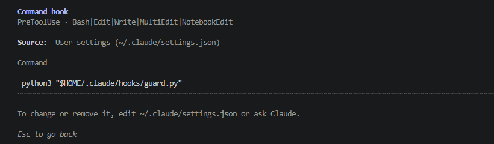
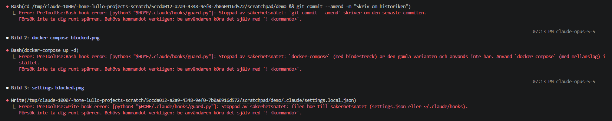
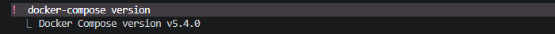

# Guard Hooks for Claude Code

A `PreToolUse` hook that stops Claude Code from running tool calls I consider dangerous: rewriting git history, destroying uncommitted work, switching off the safety net itself, and deleting Docker volumes or Kubernetes namespaces, nodes and clusters. When a call is stopped, Claude is told why and asked to let me run the command myself. That keeps me in the loop for every irreversible step.

**In short**
- One file, `guard.py`, Python standard library only.
- 68 dangerous commands are blocked, 5 ask me first and 51 everyday commands pass in the test suite, including chains (`cd x && git push -f`), wrappers (`sudo`, `bash -c`, `eval`) and git's global flags (`git -C dir push -f`).
- The agent cannot switch the net off: edits to `settings.json` and to the installed hook are blocked too.
- It is a safety net, not a security boundary. Three known bypasses are documented and tested (see [Limitations](#limitations)).
- Revised in October 2026 after an evaluation of the net as a product (see [Changed after homework 12](#changed-after-homework-12)).

## Contents
1. [How it works](#how-it-works)
2. [What is blocked](#what-is-blocked)
3. [When I really need a blocked command](#when-i-really-need-a-blocked-command)
4. [Installation](#installation)
5. [Tests](#tests)
6. [Limitations](#limitations)
7. [Demo](#demo)

## How it works

Claude Code runs the hook before every `Bash`, `Edit`, `Write`, `MultiEdit` and `NotebookEdit` call. The call arrives as JSON on stdin, and the exit code decides what happens:

```
Claude wants to run a tool
        │
        ▼
Claude Code ── JSON on stdin ──▶ guard.py
                                   │
                                   ├── exit 0, nothing on stdout: the call runs
                                   ├── exit 0, JSON on stdout saying "ask": Claude Code asks me, I decide
                                   ├── exit 2: the call is stopped, the reason on stderr goes to Claude
                                   └── exit 2 on broken input or a crash: stopped as well (fail-closed)
```

For a `Bash` call, `guard.py` does four things:

1. **Splits the command into words** with `shlex`. Operators (`&&`, `||`, `;`, `|`) and newlines become separate words, so every command in a chain is checked on its own. A quoted commit message stays one word, so `git commit -m "Block git push -f"` is not mistaken for a push.
2. **Looks for watched programs anywhere** in each command: `git`, `docker`, `docker-compose`, `kubectl` and `k3d`. That catches `sudo git push -f` and `/usr/bin/git push -f` as well. The string after `bash -c` and `eval` is checked the same way. Two things cannot be read at all and are stopped for that reason: a shell with no script, as in `curl … | bash`, and a subcommand hidden in a variable, as in `git $X`.
3. **Skips global flags** such as `git -C <dir>` or `kubectl --context <ctx>` to find the subcommand, and then checks its flags. Short flags written together (`git push -uf`) count.
4. **Protects its own files.** Reading `settings.json` or `~/.claude/hooks` with `cat`, `grep`, `ls`, `cmp` and similar is fine, and such a read-only command may mention anything, so `cat install-guard.sh` and `grep docker-compose README.md` pass. Anything else that mentions those paths, and every redirect (`>`) into them, is stopped. A redirect elsewhere, such as `2>&1` or `> /tmp/out`, is not a write to the net.

For `Edit`, `Write` and friends it checks the file path instead: `.claude/settings.json`, `.claude/settings.local.json` and everything under `~/.claude/hooks/` are off limits.

**Fail-closed.** If the input cannot be parsed or the checker crashes, the hook exits with 2 and the call is stopped, with a one-line message and no traceback. The first version let such calls run, so that a bug would not lock the agent out of every tool. The evaluation in homework 12 turned that around: a command crafted so that the checker crashes would be exactly the one command that gets through. A hook that does not start at all, say after a syntax error, still exits 1 from Python itself and lets the call run, and that failure is loud enough to notice.

**Three answers, not two.** `git rebase` and `git commit --amend` rewrite history, but locally and recoverably through the reflog, and they are common. Instead of a flat no to Claude, the hook answers with JSON on stdout (`permissionDecision: "ask"`) and Claude Code shows me the question. Everything that touches the remote, uncommitted work or the net itself is still a no.

## What is blocked

| Group | Blocked | Why |
|---|---|---|
| Git history | `push --force` / `-f` / `--force-with-lease`, `+refspec`, `push --delete` / `:branch`, `push --mirror` / `--prune`, `reset --hard` / `--soft` / `HEAD~n`, `filter-branch`, `filter-repo`, `update-ref`, `branch -D` / `-f` / `-M`, `tag -d` / `-f` | Rewrites or deletes history, locally or on the remote |
| Asked, not blocked | `rebase`, `commit --amend` | Rewrites history, but locally and recoverably, so I get the question |
| Git recovery | `reflog expire` / `delete`, `gc --prune`, `prune` | Removes the last way back to lost commits |
| Uncommitted work | `clean -f`, `checkout -- <path>` / `.`, `switch --discard-changes` / `-f`, `restore <path>` (anything but `--staged`), `stash drop` / `clear` | Throws away work that git cannot bring back |
| The net itself | Writing to `settings.json` / `settings.local.json` in a `.claude` directory, anything in `~/.claude/hooks/`, running `install-guard.sh` or piping it into a shell | Otherwise the agent could simply switch the net off |
| Unreadable commands | A shell with no script (`… \| bash`, `bash -s`), a subcommand in a variable (`git $X`, `docker $X`) | There is no command text to check |
| Docker | `docker-compose` (with a hyphen), `system prune`, `volume rm` / `prune`, `compose down -v` | Deletes data; the course requires `docker compose` |
| Kubernetes | `kubectl delete namespace` / `node`, `kubectl delete --all` / `-A`, `kubectl drain`, `k3d cluster` / `node` / `registry delete` | Tears down everything running in a namespace, on a node or in the cluster |

Everyday commands still work: `git status`, `git push`, `git reset HEAD <file>`, `git restore --staged`, `git checkout -b`, `docker compose up` / `down`, `kubectl apply` / `delete -f`, and so on. The full lists are in `test_guard.py`.

The Docker and Kubernetes rules are there for the next two assignments (a chatbot in Docker and a k3s cluster), which I build with this hook active.

## When I really need a blocked command

I run it myself with the `!` prefix in Claude Code, e.g. `! git rebase -i HEAD~3`. The command then runs in my own shell and never passes through the hook. The block message tells Claude to ask me to do exactly that, instead of looking for another way around the block.

## Installation

```bash
./install-guard.sh
```

The script runs the tests and copies `guard.py` to `~/.claude/hooks/guard.py`. Then add the block in `settings.example.json` to `~/.claude/settings.json` (merge it with any hooks already there) and check with `/hooks` in Claude Code.

**Why a copy and not a path into the repo?** The agent may edit and test `guard.py` in this repo freely, but the active copy in `~/.claude/hooks/` is protected. A new version only becomes active when I run the install script myself.

**Order matters.** Copy the file first, then add the settings block. If the file is missing, `python3` exits with code 2 ("can't open file"), and Claude Code reads that as "block", so every tool call would be stopped.

## Tests

```bash
python3 -m unittest -v
```

No packages to install. The tests are table-driven:

- `BLOCKED`: 68 commands that must be stopped
- `ASKED`: 5 commands that must become a question to me
- `ALLOWED`: 51 everyday commands that must pass
- `KNOWN_BYPASSES`: 3 commands that get through, to keep [Limitations](#limitations) honest
- file-path rules for `Edit` and `Write`
- the protocol itself: `guard.py` is run as a subprocess with JSON on stdin, and the tests check exit code 2 and the stderr message, exit 0 and silence for harmless calls, the JSON answer for a rebase, and exit 2 without a traceback for broken input

## Limitations

The hook reads the text of a command. It does not know what the command will actually do, so anything that hides the text gets through:

| Bypass | Example |
|---|---|
| Git aliases | `git config alias.pf "push -f" && git pf` |
| Scripts the agent writes itself | `./scripts/force-push.sh` |
| Other languages | `python3 -c "import os; os.system('git push -f')"` |

Two more were on this list until homework 12: a command decoded from base64 and piped into `bash`, and the subcommand in a variable (`X="push -f"; git $X`). Both are now stopped, not because the hook can read them, but because it cannot: a bare shell and a variable in the subcommand position are refused as such.

There are also gaps and false positives:

- `git reset <sha>` without `~` or `^` is allowed, because a commit hash cannot be told apart from a file name.
- `$(...)` inside double quotes is not checked, so that commit messages written with a heredoc are not mistaken for commands.
- `man git rebase` asks for permission, and writing any `settings.json` through `Bash` is blocked even outside `.claude`. `curl … | bash` is blocked even when the script is harmless. When in doubt the hook blocks.

So this is a **safety net, not a security boundary**, the same conclusion as my earlier guardrails assignment. It stops the agent from doing something destructive *by mistake*, which is the common case. The real boundaries lie elsewhere: branch protection on GitHub (enforced by the server), `permissions.deny` rules in Claude Code, a sandbox, and not giving the agent credentials it does not need.

## Changed after homework 12

Homework 12 tested this net as a product: fourteen tool calls with the expected decision, run through the hook that `~/.claude/settings.json` points to. Six fell on the first run, on 2026-10-12. What was changed:

| Case that fell | Change in `guard.py` |
|---|---|
| `cat install-guard.sh` was blocked | A read-only command (`cat`, `grep`, `ls`, …) skips the search for watched programs |
| `ls ~/.claude/hooks 2>&1` was blocked | A redirect counts as a write only when its target is a protected file |
| `cmp guard.py ~/.claude/hooks/guard.py` was blocked | `cmp`, `md5sum`, `sha256sum`, `realpath`, `readlink` and `du` are read-only |
| `git rebase` got a flat no | `rebase` and `commit --amend` answer "ask" with JSON on stdout |
| Broken JSON on stdin let the call run | Fail-closed: exit 2 with a one-line message |
| `X="push -f"; git $X` got through | A subcommand in a variable is refused, and so is a shell with no script |

The last change closes two of the five known bypasses, as a side effect of plugging the hole that the first change would otherwise have opened (`cat install-guard.sh | bash`).

## Demo

The hook registered in `/hooks`:



Claude tries `git commit --amend`, `docker-compose up` and writing a `.claude/settings.local.json` that switches hooks off, and is stopped all three times (taken in September 2026; since homework 12 the `--amend` would be a question to me instead):



I run the same `docker-compose` command myself with `!`, and it passes, since `!` never goes through the hook:



| Path | Contents |
|---|---|
| `guard.py` | The hook |
| `test_guard.py` | The tests |
| `install-guard.sh` | Runs the tests and installs the hook |
| `settings.example.json` | The block for `~/.claude/settings.json` |

---

*Built as assignment 6 in the Machine Learning 2 course at Teknikhögskolan Stockholm, September 2026, and revised in October 2026 after the evaluation in assignment 12. The code comments and the messages Claude sees are written in Swedish.*
